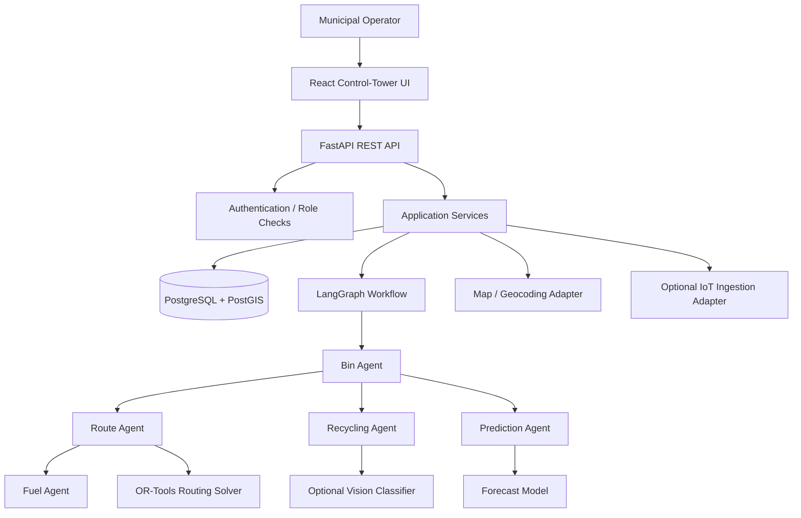

# WasteWise System Architecture

## 1. Architecture style

Use a **modular monolith** for the MVP: one FastAPI deployment, one database, clearly separated modules. The multi-agent workflow is an orchestration layer inside the backend, not five independently deployed microservices. This keeps development and debugging manageable while preserving boundaries that can later be extracted into services.

## 2. High-level diagram



## 3. Main runtime flow

1. Sensor readings or simulator updates are accepted by the ingestion service.
2. Readings are validated: fill percentage 0–100, valid bin ID, timestamp, and optional confidence / battery values.
3. Bin Agent calculates state and collection priority.
4. Prediction Agent estimates future fill levels when enough historical records exist; otherwise returns a transparent baseline or `insufficient_history`.
5. Collection candidates are sent to Route Agent.
6. Route Agent calls the routing solver with depot, truck capacity, bin coordinates, and distance matrix.
7. Fuel Agent estimates litres and cost from route distance and configured assumptions.
8. Recycling Agent enriches relevant bins or uploaded waste samples with category and handling recommendations.
9. The workflow persists a run record, selected bins, ordered route stops, metrics, warnings, and timestamps.
10. The UI renders the run result and indicates whether values are simulated, measured, or estimated.

## 4. Agent coordination

Use LangGraph as a directed state graph. A graph node can call a deterministic Python service. Do not require an LLM for numerical decisions. A graph state should include typed fields such as:

```python
class OptimizationState(TypedDict, total=False):
    run_id: str
    requested_by: str
    bin_snapshots: list[dict]
    collection_candidates: list[dict]
    forecast_results: list[dict]
    route_plan: dict
    fuel_estimate: dict
    recycling_insights: list[dict]
    warnings: list[str]
    status: str
```

Recommended graph:
`load_snapshot -> bin_agent -> prediction_agent -> route_agent -> fuel_agent -> recycling_agent -> persist_result`

The recycling step may run in parallel with prediction after the snapshot in a later optimization. Start with sequential orchestration for easier debugging.

## 5. Frontend information architecture

1. **Overview Dashboard** — KPI cards, fill-level distribution, open alerts, latest optimization run.
2. **Live Bin Map** — map markers coloured by fill status, filter by zone/status, bin details.
3. **Bins & Sensors** — searchable table, latest reading, history, simulated telemetry controls.
4. **Collection Planner** — depot/truck selector, run optimization, ordered stops, route metrics.
5. **Fleet & Fuel** — trucks, capacity, fuel type, route distance, fuel/cost estimates.
6. **Recycling Insights** — category distribution, confidence, handling recommendations.
7. **Waste Forecasts** — predicted fill level by horizon, historical vs predicted chart, uncertainty note.
8. **Agent Activity** — last run, per-agent status/duration, warnings and explainable decisions.
9. **Alerts** — overfill, sensor stale, battery low, route infeasible, forecast anomaly.
10. **Settings / Data Sources** — thresholds, fuel assumptions, demo mode, data-source health.

## 6. Backend module boundaries

- `api/routes/`: HTTP parsing, status codes, dependency injection; no domain algorithms.
- `schemas/`: Pydantic request/response types.
- `services/`: use cases and orchestration entry points.
- `agents/`: small typed decision modules; each has a narrow responsibility.
- `optimization/`: distance matrix, OR-Tools model, feasibility checks, fallback solver.
- `forecasting/`: feature preparation, baseline forecast, optional trained estimator.
- `vision/`: optional image validation and classifier adapter.
- `db/`: SQLAlchemy models, sessions, migrations.
- `core/`: configuration, logging, errors, security.

## 7. Data sources and graceful degradation

| Capability | Primary | Fallback |
|---|---|---|
| Bin fill | IoT telemetry | Seeded simulator/manual entry |
| Route distance | Routing API adapter | Haversine estimate, clearly labelled |
| Map tiles | OpenStreetMap-compatible tile provider | Route table/list if tiles unavailable |
| Forecast | Trained baseline on local history | Rolling average / insufficient-history result |
| Waste category | Optional vision model | Operator-selected category |
| AI narrative | Optional LLM | Deterministic explanation templates |

Do not scrape map tiles or assume a provider has unlimited free use. Follow each provider's terms and rate limits.

## 8. Core domain rules

- Default fill status: `NORMAL` below 70%, `WARNING` from 70% to below 90%, `CRITICAL` at 90% or higher. Make thresholds configurable.
- Candidate selection: include bins at/above collection threshold, critical bins, or bins predicted to exceed threshold within the configured planning horizon.
- A stale reading must not be silently treated as current. Mark it `STALE` and show a warning.
- Route feasibility is more important than claiming optimality. Return `FEASIBLE`, `PARTIAL`, or `INFEASIBLE` with reasons.
- Fuel estimates must state assumptions and be stored alongside the result.
- Predictions must include horizon, generated timestamp, method, and a confidence/uncertainty representation where possible.

## 9. Non-functional requirements

- API errors use a consistent shape.
- Structured logs include request/run IDs but do not log secrets.
- API endpoints paginate potentially large lists.
- Add indexes on bin ID, zone, timestamp, alert status, and optimization run ID.
- Health endpoint: `/api/v1/health`.
- API version prefix: `/api/v1`.
- Target local demo: dashboard usable on a laptop and phone; optimization for a few hundred demo bins should complete in seconds on a typical development laptop, depending on solver inputs.
